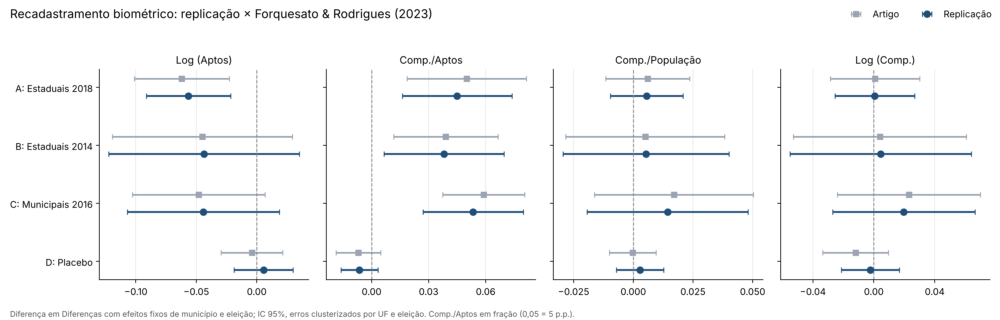
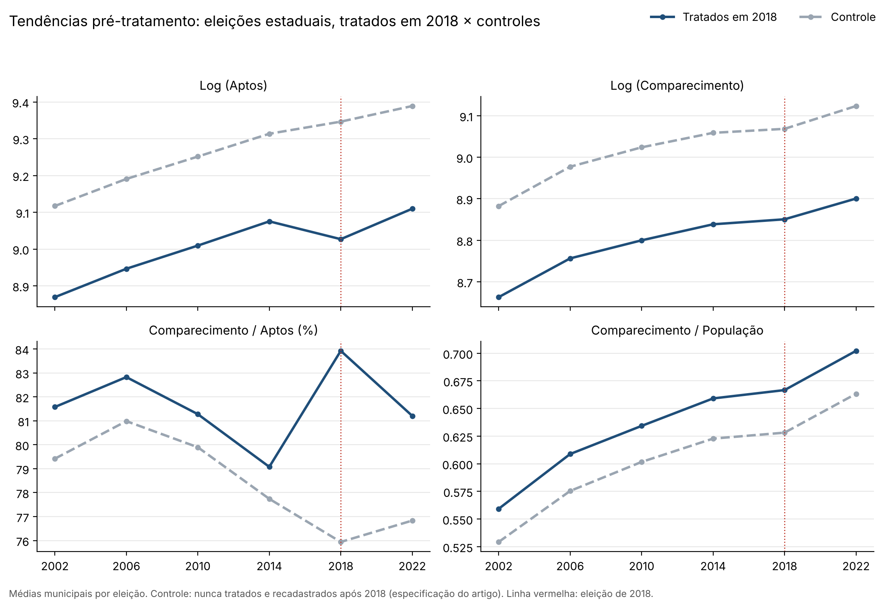

# O recadastramento biométrico reduz a participação política? Uma replicação empírica

Replicação empírica de **Forquesato & Rodrigues (2023)**, *"O recadastramento biométrico reduz a participação política?"* (*Estudos Econômicos*, v. 53, p. 495–526). O trabalho foi feito na disciplina eletiva de **Avaliação de Impactos** do curso de Ciências Econômicas da **FEAC/UFAL**.

📄 **Relatório completo:** [`relatorio/relatorio_replicacao_biometria.pdf`](relatorio/relatorio_replicacao_biometria.pdf)

---

## Pergunta

Entre 2008 e 2022, a Justiça Eleitoral fez o recadastramento biométrico obrigatório do eleitorado. O objetivo era reduzir fraudes e eliminar inscrições duplicadas. Em compensação, o recadastramento impôs custos ao eleitor, como tempo, deslocamento e busca de informação, e quem não compareceu teve o título cancelado.

**Esses custos reduziram a participação eleitoral de fato, ou o que mudou foi apenas o cadastro de eleitores?**

## Principais resultados



1. **O número de eleitores aptos cai.** Nas eleições estaduais de 2018, com a especificação do artigo, a queda é de cerca de 5,5% (no artigo, 6%). Na especificação do relatório, as quedas vão de 2,3% a 5,3%, conforme o painel.
2. **A taxa de comparecimento (comparecimento/aptos) sobe.** São 4,5 pontos percentuais em 2018 (no artigo, 5 p.p.) e de 2,0 a 3,9 p.p. na especificação do relatório.
3. **O comparecimento absoluto e o comparecimento em relação à população não se alteram.** Os efeitos são estatística e economicamente nulos em todos os painéis.

➡️ O aumento da taxa de comparecimento é um **efeito mecânico**: ele vem da limpeza do cadastro (o denominador menor), e não de mais engajamento político. Também **não há evidência de que o recadastramento tenha reduzido o número de pessoas que efetivamente votam**. Esse resultado está em linha com o artigo original.

## Estratégia empírica

- **Unidade:** município × ano, de 2002 a 2022. São 5.524 municípios e 60.770 observações.
- **Eleições:** 1º turno, eleições ordinárias para **governador** (estaduais) e **prefeito** (municipais).
- **Tratamento:** o município passa a ser tratado na primeira eleição realizada após a conclusão da revisão biométrica. Se a revisão terminou antes de outubro do ano eleitoral, ele já é tratado naquela eleição; se terminou depois, só no ciclo seguinte. Municípios ausentes do histórico do TSE nunca são tratados.
- **Estimador:** Diferença em Diferenças com efeitos fixos de município e de ano (`xtdidregress` no Stata), com erros-padrão robustos clusterizados por município.

$$y_{mt} = \alpha_m + \lambda_t + \beta \,(\text{Tratado}_m \times \text{Pós}_t) + \varepsilon_{mt}$$

- **Desfechos:** log(aptos), comparecimento/aptos (%), comparecimento/população (Censo 2010) e log(comparecimento).

## Tabelas

### Efeito do recadastramento biométrico — Diferença em Diferenças

| | Log (Aptos) | Comp./Aptos | Comp./População | Log (Comp.) |
|---|:---:|:---:|:---:|:---:|
| **Painel A — Estaduais, tratados em 2018** | **−0,053\*\*\*** (0,003) | **3,936\*\*\*** (0,096) | 0,001 (0,002) | −0,003 (0,003) |
| Tendências paralelas (`estat ptrends`) | ✔ não rejeita | ✔ não rejeita | ✘ rejeita | ✔ não rejeita |
| **Painel B — Estaduais, tratados em 2014** | **−0,023\*\*\*** (0,005) | **2,014\*\*\*** (0,140) | 0,002 (0,003) | 0,003 (0,005) |
| Tendências paralelas | ✔ não rejeita | ✘ rejeita | ✘ rejeita | ✘ rejeita |
| **Painel C — Municipais, tratados em 2016** | **−0,032\*\*\*** (0,004) | **2,609\*\*\*** (0,113) | 0,005\* (0,003) | −0,001 (0,004) |
| Tendências paralelas | ✘ rejeita | ✘ rejeita | ✘ rejeita | ✔ não rejeita |
| **Painel D — Placebo** (estaduais 2010→2014, futuros tratados em 2018) | 0,024 [p = 0,171] | −1,416 [p = 0,208] | 0,006 [p = 0,250] | 0,007 [p = 0,325] |

N = 60.770 nos painéis A–C e 11.052 no painel D. Os erros-padrão estão entre parênteses. \* p<0,10; \*\* p<0,05; \*\*\* p<0,01.
Todos os resultados estão em formato CSV em [`resultados/tabelas/resultados_did.csv`](resultados/tabelas/resultados_did.csv).

### Estatísticas descritivas

| Variável | Obs. | Média | Desvio-padrão | Mín. | Máx. |
|---|---:|---:|---:|---:|---:|
| pop_total | 60.770 | 34.178,6 | 202.492,9 | 805 | 11.253.503 |
| aptos | 60.770 | 24.584,4 | 149.821,0 | 772 | 9.301.013 |
| compa | 60.770 | 20.102,0 | 121.302,9 | 538 | 7.321.143 |
| abst | 60.770 | 4.482,3 | 29.567,2 | 9 | 2.632.587 |
| validos | 60.770 | 17.668,6 | 105.537,4 | 0 | 6.493.126 |
| prop_compa (%) | 60.770 | 82,84 | 6,76 | 16,56 | 99,37 |
| prop_pop | 60.770 | 0,647 | 0,124 | 0,096 | 1,659 |
| l_aptos | 60.770 | 9,155 | 1,085 | 6,649 | 16,046 |
| l_compa | 60.770 | 8,964 | 1,068 | 6,288 | 15,806 |
| l_abst | 60.770 | 7,294 | 1,320 | 2,197 | 14,783 |
| l_validos | 60.766 | 8,844 | 1,064 | 5,278 | 15,686 |

### Municípios tratados por eleição

| Ano | Municipal: tratados | Estadual: tratados |
|---|---:|---:|
| 2008 | 3 | – |
| 2010 | – | 59 |
| 2012 | 291 | – |
| 2014 | – | 692 |
| 2016 | 1.227 | – |
| 2018 | – | 1.833 |
| 2020 | 2.797 | – |
| 2022 | – | 1.736 |

As eleições de 2008 e 2010 foram descartadas da análise principal porque têm poucos municípios tratados. Tabela completa: [`resultados/tabelas/distribuicao_tratamento.csv`](resultados/tabelas/distribuicao_tratamento.csv).

## Tendências paralelas



No caso de referência (eleições estaduais, municípios tratados em 2018), tratados e controles seguem trajetórias aproximadamente paralelas até 2014. Em 2018, o número de aptos dos tratados cai e a taxa de comparecimento sobe, enquanto o comparecimento absoluto e em relação à população continua na mesma tendência. Os gráficos dos demais painéis (estaduais 2014 e municipais 2016) estão no [relatório](relatorio/relatorio_replicacao_biometria.pdf) e são gerados por [`05_tendencias_paralelas.do`](codigo/stata/05_tendencias_paralelas.do).

## Comparação com o artigo original

**Qualitativamente, os resultados batem com os de Forquesato & Rodrigues (2023) em todos os painéis.** O número de aptos cai, a taxa de comparecimento sobe e o comparecimento absoluto e em relação à população fica estável. As magnitudes da tabela principal acima são menores que as do artigo porque a especificação difere em quatro pontos:

| | Artigo | Tabela principal deste repositório |
|---|---|---|
| Amostra por regressão | Só um tipo de eleição (governador nos painéis A, B e D; prefeito no C) | Eleições de governador e prefeito juntas (N = 60.770) |
| Grupo de controle | Nunca tratados (nas estaduais, o N só fecha se o grupo recadastrado após 2018 também entrar) | Todos os demais municípios, inclusive os tratados em outros anos |
| Erros-padrão | Clusterizados em duas vias: UF e eleição | Clusterizados por município |
| Comparecimento/aptos | Fração (0,050 = 5 p.p.) | Pontos percentuais (3,936 = 3,9 p.p.) |

Quando a especificação do artigo é aplicada à mesma base ([`paineis_artigo` em `codigo/python/biometria/modelos.py`](codigo/python/biometria/modelos.py) e [`06_especificacao_artigo.do`](codigo/stata/06_especificacao_artigo.do)), os coeficientes ficam muito próximos dos publicados (veja a figura no início da página):

| Painel | Log (Aptos) | Comp./Aptos | Comp./População | Log (Comp.) | N |
|---|:---:|:---:|:---:|:---:|:---:|
| **A** — artigo | −0,062 (0,020) | 0,050 (0,016) | 0,006 (0,009) | 0,0008 (0,015) | 28.627 |
| **A** — replicação | −0,057 (0,018) | 0,045 (0,015) | 0,006 (0,008) | 0,0006 (0,013) | 28.649 |
| **B** — artigo | −0,045 (0,038) | 0,039 (0,014) | 0,005 (0,017) | 0,004 (0,029) | 20.479 |
| **B** — replicação | −0,044 (0,040) | 0,038 (0,016) | 0,005 (0,018) | 0,005 (0,030) | 21.802 |
| **C** — artigo | −0,048 (0,028) | 0,059 (0,011) | 0,017 (0,017) | 0,023 (0,024) | 10.904 |
| **C** — replicação | −0,044 (0,032) | 0,053 (0,014) | 0,014 (0,017) | 0,020 (0,024) | 12.162 |
| **D** (placebo) — artigo | −0,004 (0,013) | −0,007 (0,006) | −0,000 (0,005) | −0,012 (0,011) | 19.594 |
| **D** (placebo) — replicação | 0,006 (0,013) | −0,006 (0,005) | 0,003 (0,005) | −0,002 (0,010) | 19.099 |

Nessa especificação, o placebo também é pequeno e não significativo, como no artigo. As pequenas diferenças restantes vêm sobretudo dos tamanhos dos grupos (veja a nota sobre o *merge* em Limitações). Tabela completa: [`resultados/tabelas/comparacao_artigo.csv`](resultados/tabelas/comparacao_artigo.csv).

## Estrutura do repositório

```
├── relatorio/                          # relatório final (PDF)
├── codigo/
│   ├── stata/
│   │   ├── 00_master.do                # define caminhos, instala pacotes e roda tudo
│   │   ├── 01_construcao_base.do       # bases brutas → painel_final.dta
│   │   ├── 02_descritivas.do           # estatísticas descritivas e distribuição do tratamento
│   │   ├── 03_did_relatorio.do         # DiD, painéis A–C + teste de tendências paralelas
│   │   ├── 04_placebo.do               # teste placebo, painel D
│   │   ├── 05_tendencias_paralelas.do  # gráficos de tendências pré-tratamento
│   │   ├── 06_especificacao_artigo.do  # painéis A–D com a especificação do artigo
│   │   └── original/                   # script único que gerou o relatório (referência)
│   └── python/
│       ├── main.py                     # roda toda a análise em Python
│       └── biometria/
│           ├── config.py               # caminhos e constantes (inclui a Tabela 2 do artigo)
│           ├── dados.py                # leitura do painel e variáveis de tratamento
│           ├── modelos.py              # estimadores DiD (relatório e artigo)
│           └── figuras.py              # gráficos de coeficientes
├── testes/
│   └── test_replicacao.py              # testes de reprodutibilidade (pytest)
├── dados/
│   ├── README.md                       # fontes e dicionário de variáveis
│   ├── brutos/                         # não versionado: baixe seguindo dados/README.md
│   └── processados/                    # painel_final.dta (base usada nas estimações)
└── resultados/
    ├── tabelas/                        # CSVs gerados em Python (stata/ = saídas do Stata)
    └── figuras/                        # replicação × artigo e tendências pré-tratamento
```

## Como reproduzir

**Python** (não precisa de Stata), na raiz do repositório:
```bash
pip install -r requirements.txt
python codigo/python/main.py     # gera todas as tabelas e figuras em resultados/
pytest                           # roda os testes de reprodutibilidade
```

**Stata** (versão 17 ou superior, por causa do `xtdidregress`):
1. Abra `codigo/stata/00_master.do` e ajuste o `global raiz` para a pasta do repositório.
2. Rode o `00_master.do`. Ele instala `estout`, `ftools` e `reghdfe` se necessário, executa as etapas 02 a 06 e salva tabelas em `resultados/tabelas/stata/` e gráficos em `resultados/figuras/tendencias_paralelas/`.
3. *(Opcional)* Para reconstruir o painel a partir dos dados brutos, baixe as quatro bases conforme [`dados/README.md`](dados/README.md) e mude `reconstruir_base` para `1` no `00_master.do`.

### Testes de reprodutibilidade

Os 28 testes em [`testes/test_replicacao.py`](testes/test_replicacao.py) verificam que:

- o painel tem 60.770 observações e as estatísticas descritivas e a distribuição do tratamento batem com o relatório;
- os coeficientes dos painéis A–D reproduzem o relatório na 3ª casa decimal, e os p-valores do placebo também;
- a especificação do artigo reproduz a Tabela 2 de Forquesato & Rodrigues (2023), com diferença menor que 0,01 em todos os coeficientes e erros-padrão;
- as conclusões se mantêm: aptos caem, a taxa de comparecimento sobe, o comparecimento efetivo não muda e o placebo não é significativo.

Os erros-padrão do `xtdidregress` diferem dos do Python a partir da 3ª casa decimal, por diferenças na correção de graus de liberdade. Com cluster em duas vias (UF e eleição), os p-valores usam t com min(G) − 1 graus de liberdade, como o `reghdfe`.

## Limitações e notas de robustez

- **Merge por nome.** A base de revisões do TSE foi unida às eleições pelo nome do município e pela UF. Das 4.545 revisões, 225 não encontraram correspondência por diferenças de grafia (por exemplo, "assú" × "açu" e "embu das artes" × "embu"). Esses municípios acabaram classificados como nunca tratados: são 1.206 nunca tratados aqui, contra 1.026 no artigo. Fazer o *merge* pelo código IBGE resolveria isso.

- **Grupo de controle.** Em cada painel, o grupo tratado é comparado com *todos os demais municípios*, inclusive os tratados em outros anos, e não apenas com os nunca tratados. Com adoção escalonada, o estimador TWFE pode ser enviesado (Goodman-Bacon, 2021). Uma extensão natural seria usar estimadores robustos a esse problema, como Callaway & Sant'Anna (2021) ou `csdid`/`did_multiplegt`.
- **Tendências paralelas.** O teste formal rejeita a hipótese em várias especificações (veja a tabela acima), sobretudo nos painéis B e C. Esses resultados devem ser lidos com cautela.
- **Placebo.** No Painel D, os erros são clusterizados por UF e ano. Como há apenas 2 anos, o Stata usa 1 grau de liberdade, o que gera p-valores altos mesmo quando as estatísticas t são grandes. Com erros clusterizados por município, os efeitos placebo passam a ser estatisticamente significativos. Assim, a ausência de efeitos antecipados não é conclusiva.

## Referências

- FORQUESATO, P.; RODRIGUES, P. O recadastramento biométrico reduz a participação política? *Estudos Econômicos*, v. 53, p. 495–526, 2023.
- TSE. [Biometria](https://www.justicaeleitoral.jus.br/biometria/) e [Histórico das Revisões Biométricas](https://sig.tse.jus.br/ords/dwtse/f?p=164:12).
- [Base dos Dados — Eleições brasileiras](https://basedosdados.org/dataset/eef764df-bde8-4905-b115-6fc23b6ba9d6).
- [Atlas Brasil — População total](http://www.atlasbrasil.org.br/).

## Autor

**Charliton da Silva Nogueira**, graduando em Ciências Econômicas na FEAC/UFAL.
✉️ charliton.nogueira@feac.ufal.br
